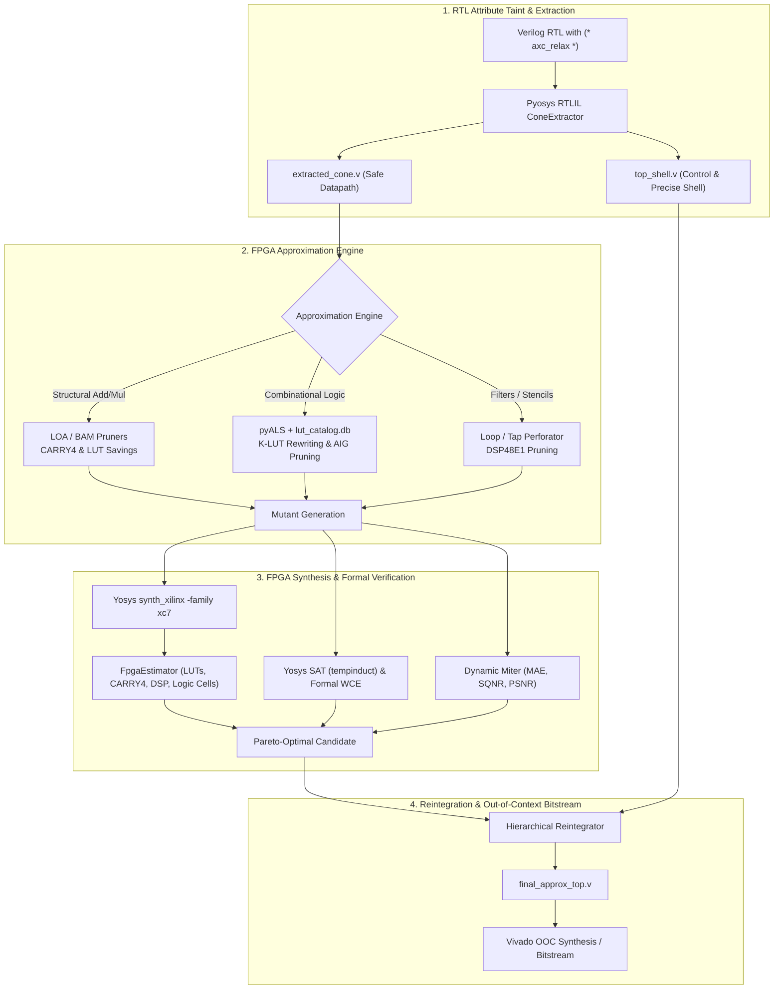

# axc-fpga-flow: FPGA-Specialized Approximate Computing Architecture & Flow

This skill provides comprehensive instructions, architectural guidelines, and automation recipes for designing, approximating, and verifying approximate hardware accelerators on FPGA architectures (specifically **Xilinx 7-Series / Artix-7 `xc7a35t`**).

Unlike ASIC flows that focus on standard-cell area ($\mu\text{m}^2$) and Liberty timing libraries, the **FPGA flow** is governed by discrete, tiled hardware primitives:
1. **Configurable Logic Blocks (CLBs)**: Slices with 6-input Look-Up Tables (`LUT6`), split 5-input LUTs (`LUT5`), and flip-flops (`FDRE`/`FDSE`).
2. **Dedicated Arithmetic Fast Carry Chains (`CARRY4`)**: 4-bit dedicated multiplexer/XOR carry structures per slice. Carry chain reduction is critical for saving FPGA logic cells and reducing critical path delay.
3. **Dedicated DSP Blocks (`DSP48E1`)**: $25 \times 18$ multiplier, adders, and 48-bit accumulators.
4. **Logic Cells Metric**: Modeled as $LC = \text{LUT} + 2 \times \text{CARRY4} + 100 \times \text{DSP48E1}$.

---

## 1. Approximation Engines

### 1.1 pyALS, pyALSlib & pyALS-LUT-Catalog Engine
The primary approximation engine in `AxFPGA` replaces ASIC-centric AxLS with **pyALS**:
- **Repositories Integrated**:
  - `pyALS`: Python Approximate Logic Synthesis orchestration engine.
  - `pyALSlib`: Core library providing AIG graph manipulation (via `pyosys` & `python-igraph`), BDD/truth-table extraction, AMOSA multi-objective optimization, and error metric evaluators (WCE, MAE, MRE, Hamming distance).
  - `pyALS-lut-catalog`: Pre-characterized SQLite catalog (`lut_catalog.db`) containing 2,244 truth-table entries evaluated for structural error and distance across 2-, 4-, 8-, 16-, 32-, and 64-bit truth tables.
- **LUT Matching & Bit Reversal**:
  In Yosys, K-LUTs are emitted either as `\$lut` cells or shift-right expressions:
  ```verilog
  assign wire = 16'hABCD >> {in3, in2, in1, in0};
  ```
  `pyALS` maps LUT truth tables in reverse bit order:
  `spec = bin(int(hex_val, 16))[2:].zfill(lut_size)[::-1]`
  Candidates are retrieved from `lut_catalog.db` matching `orig_spec` with Hamming distance $d_H \in [1, d_{\text{max}}]$:
  ```sql
  SELECT approx_spec, hd, wce FROM lut_catalog WHERE orig_spec = ? AND hd <= ? ORDER BY hd ASC;
  ```
  The rewritten truth table replaces the original mask, simplifying the downstream LUT mapping in Vivado/Yosys.

### 1.2 FPGA Arithmetic Approximators: LOA & BAM
In addition to catalog rewriting, `AxFPGA` includes FPGA-native structural arithmetic transforms:
- **Lower-Part OR Adder (LOA)**:
  - Divides an $N$-bit adder into $K$ approximate LSBs and $(N-K)$ precise MSBs.
  - Approximate LSBs: $Sum_i = A_i \lor B_i$ (implemented with 1 LUT per 2 bits in Artix-7 dual-output LUTs).
  - Fast Carry-Chain Pruning: Completely eliminates $\lceil K/4 \rceil$ `CARRY4` primitives.
  - Carry-in to MSB: $Cin_{\text{precise}} = A_{K-1} \land B_{K-1}$.
- **Broken Array Multiplier (BAM)**:
  - For soft-logic multipliers (non-DSP), truncates both horizontal ($h$) and vertical ($v$) partial-product diagonals:
  - Eliminates $(h \cdot N + v \cdot M - h \cdot v)$ partial product AND gates and downstream CARRY4 addition trees.

### 1.3 Algorithm & Architecture Perforation
- **RTL Loop / Tap Perforation**:
  - Drops symmetric or low-magnitude taps in FIR/IIR filters.
  - Drops stencil neighbors (e.g. 9-tap 2D convolution reduced to 5-tap cross).
  - Translates directly into saved `DSP48E1` or pipelined MAC logic slices.

---

## 2. Directory Structure of `AxFPGA`

```
AxFPGA/
├── axfpga/                       # Core python package (installed as editable)
│   ├── __init__.py
│   ├── pyals_bridge.py           # pyALS & lut_catalog.db integration bridge
│   ├── fpga_backend.py           # LOA, BAM, pyALS approximation tournament backend
│   ├── fpga_estimator.py         # Xilinx 7-series LUT, CARRY4, DSP, LC estimator
│   ├── perforator.py             # RTL AST loop & tap perforator
│   ├── cone_extractor.py         # Pyosys RTLIL cone extractor (axc_relax / axc_precise)
│   ├── trace_extractor.py        # Top-level realistic trace simulation
│   ├── reintegrator.py           # Hierarchical cone reintegrator
│   ├── verifier.py               # Yosys SAT formal & dual-miter verifier
│   ├── flow.py                   # Unified axfpga CLI & pipeline orchestrator
│   ├── sweep.py                  # FPGA Pareto frontier explorer
│   ├── budgeter.py               # Multi-stage cascaded error budgeter
│   └── lut_catalog.db            # SQLite database with 2,244 pre-characterized LUTs
├── pyALS/                        # SalvatoreBarone pyALS repo
├── pyALSlib/                     # SalvatoreBarone pyALSlib repo (installed in venv)
├── pyALS-lut-catalog/            # SalvatoreBarone pyALS-lut-catalog repo & SQL schema
├── tests/                        # Full test suite
├── .agent/skills/axc-fpga-flow/  # Workspace agent skill
├── pyproject.toml                # Build configuration
└── README.md                     # Documentation
```

---

## 3. End-to-End Workflow



---

## 4. Key CLI Commands & APIs

### 4.1 Running the FPGA Approximation Flow via CLI
```bash
# In Python 3.12 virtualenv (/home/christos-ntoumas/axc_yosys_flow/.venv)
axfpga run-fpga \
    --top-file top.v \
    --top-module top \
    --engine pyals \
    --metric wce \
    --bound 16 \
    --out-dir ./approx_results
```

### 4.2 Using the Python API
```python
from axfpga.flow import AxFPGAFlow, FlowConfig
from axfpga.pyals_bridge import PyAlsBridge
from axfpga.fpga_estimator import FpgaEstimator

# Configure flow for Xilinx Artix-7 target
config = FlowConfig(
    top_file="mac.v",
    top_module="mac",
    target="fpga",
    fpga_part="xc7a35ticsg324-1L",
    error_metric="wce",
    error_bound=8.0,
    engine="pyals",
    catalog_path="/home/christos-ntoumas/AxFPGA/axfpga/lut_catalog.db"
)

flow = AxFPGAFlow(config)
report = flow.run(output_dir="./out_mac_fpga")
print(f"Baseline Logic Cells: {report.baseline_area['logic_cells']}")
print(f"Approx Logic Cells:   {report.approx_area['logic_cells']}")
print(f"Savings:              {report.area_savings_pct:.2f}%")
```

### 4.3 Running Pareto Sweeps
```python
from axfpga.sweep import ParetoSweeper, SweepConfig

sweep_cfg = SweepConfig(
    top_file="fir_filter.v",
    top_module="fir_filter",
    target="fpga",
    metric_bounds=[0, 2, 4, 8, 16, 32, 64]
)
sweeper = ParetoSweeper(sweep_cfg)
pareto_results = sweeper.run_sweep()
```

---

## 5. FPGA Design Best Practices

1. **Protect Fast Carry Chains**: If an adder cannot tolerate approximation, mark it with `(* axc_precise *)` so `ConeExtractor` leaves the dedicated `CARRY4` chain unmodified.
2. **Prioritize Carry Chain Reduction in Approximate Regions**:
   - For soft-logic arithmetic, `CARRY4` cells often dominate timing delay. Pruning lower carry stages with `LOA` yields dual benefits: immediate logic cell reduction ($1 \text{ CARRY4} = 2 \text{ Logic Cells}$) and significant path delay reduction.
3. **Exploit 6-LUT Dual Outputs**:
   - Two 5-input functions sharing inputs can fit into a single Xilinx `LUT6_2`. When mapping approximate cones via `pyALS`, targeting 4-LUT or 5-LUT truth tables maximizes LUT packing density in Vivado.
4. **DSP48E1 vs. Fabric Trade-offs**:
   - On Artix-7 `xc7a35t`, only 90 DSP slices are available. If DSP count is saturated, converting approximate multiplications to truncated shift-add/BAM trees saves DSPs for precise pipeline stages.
